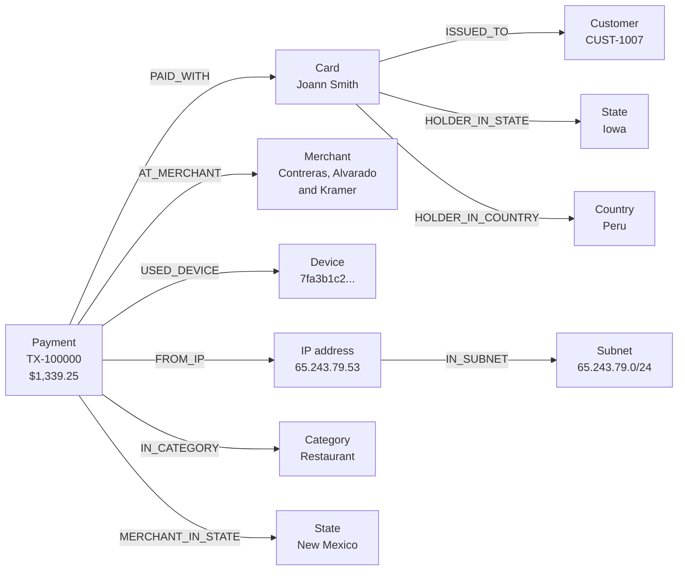
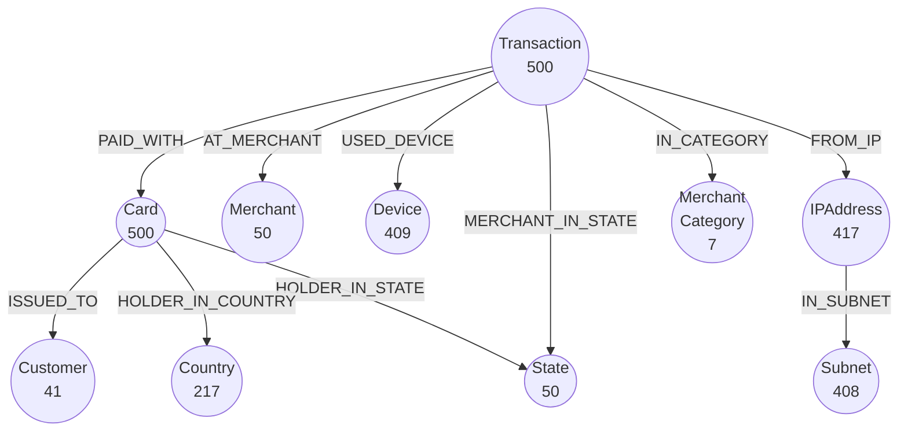
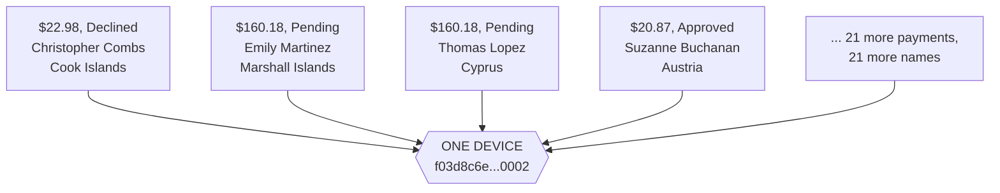
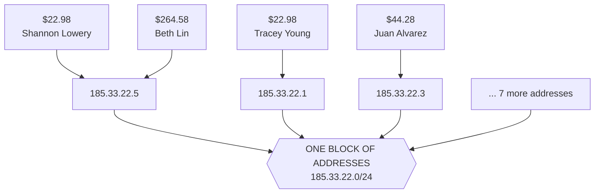
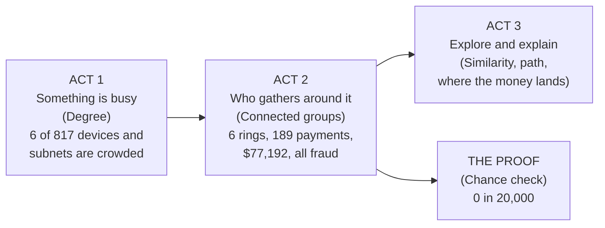

# The fraud graph and the algorithms we run on it, in plain English

Written 2026-10-01 for the BIS demo. Every number here was measured on a copy of the live EC2 graph taken the same day, and the main ones were checked a second time straight from the source CSV file.

---

## 1. The one-minute version

- Our graph holds **500 card payments** made over one month (24 Oct to 23 Nov 2025). It is practice data, not real customers.
- 406 of the 500 payments are marked as fraud. That is 81%, far higher than real life, so "is it fraud?" is not an interesting question here. The interesting question is **"which frauds are organised?"**
- We run a small number of graph algorithms. Together they find **six hidden groups ("rings")** of payments that secretly share the same phone/computer or the same internet connection.
- Those six rings hold **189 payments worth $77,192**. Every single one is fraud. Outside the rings, 217 of 311 payments are fraud (70%).
- The rings are 38% of the payments but **68% of all the fraud money** ($77,192 of $112,817).
- The algorithms never look at the fraud mark. They only look at who shares what. The fraud mark is used afterwards, to check whether the groups they found are real.

That is the whole story: **people who look unrelated on paper are tied together by something they share, and a graph makes that visible in one step.**

---

## 2. The data

### 2.1 Where it came from

One spreadsheet, `CreditCard_Fraud_01.csv`, with 500 rows and 30 columns. Each row is one payment and repeats everything about it: the card, the card holder, the shop, the device, the internet address.

A spreadsheet row is flat. A graph breaks the row into separate **things** (called nodes) and **links** between them (called relationships). When two rows mention the same device, both rows link to the *same* device node. That shared node is what makes hidden connections visible.

### 2.2 One real row, turned into a graph

Here is payment `TX-100000` exactly as stored:

| Column | Value |
|---|---|
| Payment | TX-100000, $1,339.25, 8 Nov 2025 00:47, status Declined, marked fraud |
| Card | 3528406316760180 (Amex), holder Joann Smith, Iowa, country Peru, account CUST-1007 |
| Shop | Contreras, Alvarado and Kramer (a restaurant in New Mexico) |
| Device | 7fa3b1c2-9d44-4f7e-b210-3c9e6e120004 |
| Internet address | 65.243.79.53, which sits in the block 65.243.79.0/24 |

As a graph, that one row becomes this picture:



Looked at alone, this payment is unremarkable. It becomes interesting because **17 other payments, on 17 other cards, point at that same device node**. You cannot see that from the row. You can see it from the graph.

### 2.3 The ten kinds of things (nodes)

Total: **2,599 nodes**.

| Kind of thing | How many | What it is, in plain words | What we store on it |
|---|---|---|---|
| **Transaction** | 500 | One payment | id, amount, date and time, status (Approved / Pending / Failed / Declined), fraud mark (1 or 0), shop category, shop city and state, shop risk score, high-risk-shop flag, plus the card number, shop id, device id and internet address it used |
| **Card** | 500 | One payment card and the person on it | card number, type (Amex / Visa / Discover / Mastercard), limit, issue and expiry date, holder name, address, state, country, zip, credit score, date joined, risk level (Low / Medium / High), account id |
| **Customer** | 41 | An account number such as CUST-1007 | only the account id |
| **Merchant** | 50 | A shop | shop id, shop name |
| **Device** | 409 | The phone or computer the payment was made from | device id |
| **IPAddress** | 417 | The internet address the payment came from | the address, and the block it belongs to |
| **Subnet** | 408 | A block of 256 neighbouring internet addresses, like one street of houses | the block (for example 185.33.22.0/24) |
| **MerchantCategory** | 7 | Type of shop: Online Retail, Fuel, Travel, Grocery, Electronics, Clothing, Restaurant | the category name |
| **State** | 50 | A US state | the state name |
| **Country** | 217 | A country | the country name |

Every node also carries two housekeeping values: `namespace` (always `creditcard_fraud`, the name of this dataset inside the database) and `source` (the file it came from).

### 2.4 The ten kinds of links (relationships)

Total: **4,917 links**. None of them carries any extra information of its own; a link only says "these two are connected".

| Link | From | To | How many | Plain meaning |
|---|---|---|---|---|
| PAID_WITH | Transaction | Card | 500 | this payment used this card |
| AT_MERCHANT | Transaction | Merchant | 500 | this payment went to this shop |
| USED_DEVICE | Transaction | Device | 500 | this payment was made from this device |
| FROM_IP | Transaction | IPAddress | 500 | this payment came from this internet address |
| IN_CATEGORY | Transaction | MerchantCategory | 500 | the shop was of this type |
| MERCHANT_IN_STATE | Transaction | State | 500 | the shop is in this state |
| ISSUED_TO | Card | Customer | 500 | this card belongs to this account |
| HOLDER_IN_STATE | Card | State | 500 | the card holder lives in this state |
| HOLDER_IN_COUNTRY | Card | Country | 500 | the card holder's country |
| IN_SUBNET | IPAddress | Subnet | 417 | this address sits in this block |

### 2.5 The whole schema in one picture



The Transaction sits in the middle. Everything else hangs off it or off the Card.

### 2.6 Five quirks of this data you must know

These decide which algorithms make sense. If someone asks "why didn't you run X?", the answer is usually one of these.

1. **Every payment has its own card.** 500 payments, 500 cards, never a card used twice. So "Card" and "Transaction" are really one-to-one, and the Card is our stand-in for "a person".
2. **The account number (Customer) means nothing.** The same account number appears with different names, addresses and credit scores on every row. 40 of the 41 accounts touch a ring. Any algorithm run on Customers produces one big meaningless blob.
3. **81% of payments are marked fraud.** So the fraud mark alone cannot separate interesting from boring. We use it only as a check.
4. **Countries are random.** 217 countries across 500 rows. There is no geographic story to tell.
5. **Almost nothing is shared.** 404 of 409 devices are used by exactly one payment. 407 of 408 subnets are used by exactly one payment. This is what makes the few shared ones stand out so sharply.

---

## 3. What is a "graph algorithm"?

A query answers a question you already know how to ask: *"show me payments over $1,000 at restaurants."*

A graph algorithm answers a question about **shape**: *"which things clump together?"*, *"which thing is unusually busy?"*, *"which two things look alike?"* You do not tell it what to find. It looks at the pattern of links and reports back.

"GDS" (Graph Data Science) is simply the name for a toolbox of such algorithms.

### 3.1 First we choose what the algorithm is allowed to see

This step is called a **projection**. It matters more than the choice of algorithm.

Think of it like this: if you ask "who is connected to whom?" and you count *"both bought fuel"* as a connection, then everybody is connected to everybody, because there are only 7 shop categories for 500 payments. The answer is useless.

So we hide the things that everyone shares for innocent reasons, and keep only the things that should **not** be shared:

| We keep | Why |
|---|---|
| Transaction | the thing we are grouping |
| Device | two strangers should not pay from the same phone |
| Subnet | two strangers should rarely pay from the same small block of internet addresses |

| We hide | Why |
|---|---|
| MerchantCategory, State, Country | everyone shares these; they glue the whole graph into one lump |
| Merchant | many honest people use the same shop |
| Customer | meaningless in this data (quirk 2) |

The picture the algorithms see looks like this. Most payments are alone; a few crowd around one shared device or one shared subnet:

```
   ordinary payments (311 of them)            a ring

   [payment]--(device)                   [payment]  [payment]  [payment]
       |                                       \        |        /
   (subnet)                                     \       |       /
                                                 ( ONE DEVICE )
   [payment]--(device)                          /       |       \
       |                                       /        |        \
   (subnet)                              [payment]  [payment]  [payment]

   each has its own device                 many payments, many cards,
   and its own subnet                      many names, one device
```

---

## 4. The algorithms we apply

For each one: the idea, an everyday example, what it found on our data, why we chose it, and what it cannot tell you.

### 4.1 Degree: "who is unusually busy?"

**The idea.** Count how many links each thing has. That is all.

**Everyday example.** In a village, most houses receive post for one family. One house receives post for 25 different families. You have not proved anything yet, but you know which door to knock on first.

**Tiny example.**

```
Device A --- payment 1                 Device B --- payment 2
                                       Device B --- payment 3
                                       Device B --- payment 4
   degree of A = 1                        degree of B = 3
```

**What it found on our data.**

| How many payments used it | Devices | Subnets |
|---|---|---|
| exactly 1 | 404 | 407 |
| 16 | 1 | 0 |
| 18 | 2 | 0 |
| 19 | 1 | 0 |
| 25 | 1 | 0 |
| 93 | 0 | 1 |

Out of 817 devices and subnets, **six are busy and 811 are not**. There is nothing in between. That clean gap is the first slide of the story.

**Why we chose it.** It is the simplest possible signal, anyone can follow it, and it tells us where to look.

**What it cannot tell you.** It points at the busy device. It does not hand you the list of people gathered around it as one named group. The next algorithm does that.

### 4.2 Connected groups: "who belongs together?"

Technical name: Weakly Connected Components, usually shortened to WCC.

**The idea.** Start at any node. Walk along every link you can. Everything you can reach is one group. Then pick a node you have not visited and repeat. At the end, every node has a group number.

**Everyday example.** Give everyone at a party a piece of string and ask them to hold one end with anyone they came with. Then pull. Each clump of people that moves together is one group. Someone who came alone moves alone.

**Tiny example.**

```
[pay 1]---(device X)---[pay 2]          [pay 4]---(device Z)
               |
            [pay 3]                     [pay 5]---(device W)

   group 1: pay 1, pay 2, pay 3, device X
   group 2: pay 4, device Z
   group 3: pay 5, device W
```

**What it found on our data.** 317 groups in total. 311 of them are a single payment with its own device and subnet. The other **six are the rings**:

| Ring | What they share | Payments | Different cards | Total | Marked fraud |
|---|---|---|---|---|---|
| 1 | Subnet 185.33.22.0/24 | 93 | 93 | $43,080.59 | 93 of 93 |
| 2 | Device f03d8c6e...0002 | 25 | 25 | $7,839.82 | 25 of 25 |
| 3 | Device 5bb8f082...0003 | 19 | 19 | $8,932.21 | 19 of 19 |
| 4 | Device 7fa3b1c2...0004 | 18 | 18 | $6,431.79 | 18 of 18 |
| 5 | Device a4c19e22...0000 | 18 | 18 | $5,666.46 | 18 of 18 |
| 6 | Device c91f44d0...0001 | 16 | 16 | $5,241.43 | 16 of 16 |
| **All six** | | **189** | **189** | **$77,192.30** | **189 of 189** |

The six rings do not overlap. No payment sits in two of them.

**A real look inside ring 2** (four of its 25 payments):



Four different names, four different countries, four different internet addresses, and one phone. Two of them even paid the identical amount, $160.18, fourteen hours apart.

**The rings use two different tricks**, and it is worth saying so in the demo:

- **Rings 2 to 6 (device rings):** one device, many cards, and a *different* internet address every time. The fraudster hides the network but forgets the device gives them away.
- **Ring 1 (subnet ring):** 93 payments from 93 *different* devices, but all from ten neighbouring internet addresses (185.33.22.0 to 185.33.22.9), each used 5 to 12 times. The fraudster changes device every time but keeps coming out of the same small block.



This is why the **Subnet** node exists in our schema. The ten addresses are different, so looking at addresses alone shows nothing. Only when each address is linked to its block do the 93 payments meet at one point.

**Why we chose it.** It is the headline. It turns "a busy device" into "a named group of 25 payments by 25 supposedly different people". It is cheap to run, and it is easy to explain to an investigator: *these belong together because they share this.*

**What it cannot tell you.** It does not say *how strongly* things are tied, only that they are. And if we had let it see shop categories, it would have glued all 500 payments into one group. Its answer is only as good as the choice in section 3.1.

### 4.3 The chance check: "could this just be luck?"

This is not a graph algorithm. It is the proof that the groups mean something, and it is what makes the result honest.

**The worry.** 81% of all payments are fraud anyway. So any group will be mostly fraud. Is "189 out of 189" actually surprising?

**Everyday example.** A bag holds 500 marbles: 406 red, 94 blue. Close your eyes and pull out 189. How often will all 189 be red?

**What we did.** We let the computer pull 189 payments at random, 20,000 times, and counted how often all 189 were fraud.

**Result: 0 times out of 20,000.**

So the rings are not "mostly fraud because everything is mostly fraud". They are pure, and that does not happen by luck.

| | Payments | Marked fraud | Share |
|---|---|---|---|
| Inside the six rings | 189 | 189 | 100% |
| Everything else | 311 | 217 | 70% |
| Whole dataset | 500 | 406 | 81% |

**Why this matters for the demo.** The algorithms found the groups *without being told which payments were fraud*. The fraud mark was only used afterwards. That is the difference between "we drew a nice picture" and "we found something".

### 4.4 Similarity: "who looks like whom?"

Technical name: Node Similarity, using the Jaccard score.

**The idea.** For two things, list what each one is linked to. Then: *how many items are on both lists, divided by how many items are on either list.* The answer runs from 0 (nothing in common) to 1 (identical).

**Everyday example.** Your shopping basket: bread, milk, eggs. Mine: bread, milk, tea. We share 2 items. Together we have 4 different items. Similarity = 2 / 4 = 0.5.

**Tiny example from our data.**

```
Christopher Combs's card  ->  { device f03d8c6e , subnet 195.13.208.0 }
Emily Martinez's card     ->  { device f03d8c6e , subnet 1.99.113.0   }

shared:        1  (the device)
all different: 3  (one device + two subnets)
similarity:    1 / 3 = 0.33
```

**What it found on our data.** Out of 124,750 possible pairs of cards, **5,175 pairs** share something, and they are exactly the pairs inside the six rings. Every one of them scores 0.33. Every other pair scores 0.

**Why we chose it.** It powers the drill-in. In the demo, someone clicks one card and asks *"who else looks like this one?"* Similarity answers with a ranked list. It also writes a direct "similar to" link between two cards, which is easier to show on screen than the path through payment and device.

**What it cannot tell you, and you should say so if asked.** On this data it adds **no new finding**. It re-discovers the same six rings. Its value here is as a way to explore, not as extra evidence. On richer data, where people share two or three things in different combinations, the scores would differ and it would rank the closest look-alikes first.

### 4.5 Where the ring money lands

**The idea.** For each shop, what share of its payments come from ring members? Across all shops the average is 38%. If a shop is far above that, it may be where the rings cash out.

**Everyday example.** If 38% of a town's residents are tourists, you expect roughly 38% of each cafe's customers to be tourists. A cafe where 80% are tourists is doing something different.

**What it found on our data.**

| Shop | Ring payments | All payments | Ring share |
|---|---|---|---|
| Martin Ltd | 5 | 6 | 83% |
| Mcclure, Bridges and Lucas | 7 | 9 | 78% |
| Hensley, Price and Richardson | 6 | 8 | 75% |
| ... | | | |
| Sanchez-Ruiz | 2 | 17 | 12% |
| Stout-Watson | 1 | 16 | 6% |

**Is that just luck?** We shuffled the ring marks randomly across the 500 payments 5,000 times, twice with different starting points, and measured how uneven the shops came out. Only 27 and 35 of 5,000 shuffles were as uneven as the real data (about 0.5% to 0.7%). So the unevenness across shops as a whole is real.

**The limit you must state.** Each shop has only 2 to 27 payments. We can say "ring money is spread unevenly across shops". We cannot fairly point at one shop and call it guilty on 5 payments out of 6. This is a supporting act, not a headline.

### 4.6 Shortest path: "show me exactly how these two are connected"

**The idea.** Find the fewest steps from one thing to another.

**Everyday example.** "How do I know the mayor?" My neighbour's sister works for him. That is a path of three steps.

**On our data.**

```
Christopher Combs's card <- payment -> device f03d8c6e <- payment -> Emily Martinez's card
```

Four steps, and the shared device sits in the middle. We use this as the **explanation on screen**: after the algorithm says two cards belong to the same ring, the path shows the investigator *why* in one line.

---

## 5. What we are trying to say with all this

### 5.1 The intent

We are not trying to show that we can detect fraud. The data already has a fraud column. We are showing something a table cannot do:

> **Things that look unrelated one row at a time are connected through something they share. A graph finds those connections on its own, groups them, and can show the reason.**

### 5.2 The story in three acts



1. **Act 1.** Almost everything is used once. Six things are crowded.
2. **Act 2.** Around those six sit 189 payments by 189 "different" people. All fraud. Could not be luck.
3. **Act 3.** Click any card: who else looks like it, how exactly they connect, and which shops the ring money went to.

### 5.3 Why this matters to BIS

BIS does not police card fraud. It polices exports: who is shipping controlled goods, to whom, and whether the stated buyer is the real one. The shape of the problem is the same. A known warning sign in export control is several supposedly independent companies that turn out to share one address, one agent or one phone number.

| In our fraud graph | The same idea in export control |
|---|---|
| Payment | A shipment or export filing |
| Card and its holder | An exporter or a named party to the shipment |
| Device shared by many cards | One address, phone or freight forwarder shared by many "independent" companies |
| Subnet with ten rotating addresses | One building or registered agent with many suite numbers |
| Merchant | The consignee (who receives the goods) |
| Merchant category | Type of goods |
| "Where the ring money lands" | Which consignees receive most of the linked shipments, a possible diversion point |

We should say plainly that this is an analogy on practice data, not export data.

---

## 6. Two ways to run the demo (for seniors to choose)

### View A: one strong story on the data we already have

- Exactly sections 4 and 5 above. Three algorithms plus the chance check.
- **For:** everything is already measured and true of the live graph. Nothing new to build except the HTML page. Low risk for a demo three days away.
- **Against:** only one real finding. Anyone who asks for community detection, risk spreading or "brokers between groups" gets the honest answer that this data has none of that to find (see section 7).

### View B: a richer practice dataset built for the demo

- We would build a new dataset with deeper structure: for example parties that share addresses *and* phone numbers in different combinations, goods passing through two or three middlemen before reaching the end user, and one broker sitting between two otherwise separate groups.
- **Unlocks:** community detection (splitting one large tangle into sub-groups), "broker" scoring, risk spreading from a known bad party, and similarity scores that actually differ from pair to pair. It could use export vocabulary directly.
- **For:** a fuller tour of the toolbox, and it speaks BIS's language.
- **Against:** costs most of a day to build and check. And the patterns would be ones **we planted ourselves**, so the algorithms "finding" them proves the method works, not that we discovered anything. It must be presented as illustrative.

Both can be shown: View A as "this is on the live graph today", View B as "this is what the same method does on a deeper network".

---

## 7. The wider list of fraud algorithms, and what each does on our data

A senior asked which GDS algorithms suit fraud in general and received a standard list. Here is every item on it, what it means in plain words, and what happens when it meets *this* dataset. Items marked "tested" were actually run on the copy of the live graph.

| Algorithm | Plain meaning | On our data |
|---|---|---|
| **Connected groups (WCC)** | Who belongs together | **Used. The headline.** Tested: 6 rings |
| **Degree** | Who is unusually busy | **Used. The opening.** Tested: 6 busy out of 817 |
| **Node Similarity** | Who looks like whom | **Used for drill-in.** Tested: re-finds the same rings, no new finding |
| **Shortest path** | How exactly are two things connected | **Used to explain a link on screen** |
| **Louvain / Leiden** | Split a large tangle into tighter sub-groups | Not useful here. Our rings are already separate, so there is nothing to split. Tested: it wrongly chops the 93-payment ring into 83 fragments, because a ring shaped like a star (many points, one centre) has no "tighter sub-group" inside it |
| **Label Propagation** | A faster cousin of Louvain | Same situation as Louvain. Not tested |
| **Triangle count / clustering** | Do my friends also know each other? | Tested: zero triangles in the whole picture. Payments link to devices, never to each other, so a triangle cannot form |
| **K-core** | Peel away loosely attached things to find a dense core | Tested: everything lands in the same lowest layer. No dense core exists |
| **PageRank / Personalized PageRank** | Spread "suspicion" outward from known bad things | Tested from 10 known ring payments on the full graph: one ring device came top, then the suspicion drained into the 7 shop categories, because everything links to them. This is the "supernode" problem the list itself warns about |
| **Betweenness** | Who sits on the route between groups (a broker or mule) | Tested: it only re-finds the busy subnet. Our rings do not connect to each other, so there is no broker between them |
| **Embeddings + classification (FastRP, GraphSAGE, node classification)** | Turn the graph into numbers and train a model to predict fraud | Not suitable. 500 rows with 81% already fraud is too small and too lopsided to train or fairly test a model. Not tested |
| **KNN** | Find look-alikes using properties | Card holder details are random in this data (quirk 2), so look-alikes by property would be noise. Not tested |
| **Link prediction** | Guess missing links | Nothing is missing here; every link comes straight from the spreadsheet. Not tested |
| **Strongly connected groups / cycles** | Find money going round in a circle | Not possible here. Cards pay shops; nobody pays anybody back, so no circle can exist |
| **BFS / DFS** | Walk outward from one node | This is what the Explorer already does when you expand a node |

The list also gives three tips. All three apply to us:

- *"Supernodes distort results, so filter them."* That is exactly section 3.1: we hide categories, states and countries.
- *"Validate against known labels."* That is section 4.3, the chance check.
- *"Start with WCC, then degree and similarity."* That is our Act 1 to Act 3.

So our choice is not a different opinion from the list. It is the first half of the list's own recommended workflow. We stop there because the second half (splitting large groups, spreading risk, training a model) needs structure this dataset does not contain. View B in section 6 is how we would show that second half.

---

## 8. Questions you may be asked, with honest answers

**"Is this real data?"**
No. It is practice data with fraud rings placed in it on purpose. The point is the method.

**"81% fraud is not realistic."**
Correct. That is why we never use the fraud mark to find anything. We use it only to check the groups afterwards, and we compare rings (100%) against the rest (70%), not against zero.

**"Couldn't a simple count in a spreadsheet find the busy device?"**
For the device rings, yes, a count would flag the device. Two things it would not give you: the subnet ring, where the ten addresses are all different and only meet one step further away; and the group itself as a single object you can open, explore and hand to an investigator.

**"Did the algorithms run inside Grasph?"**
Not yet. The data lives in Grasph and the Explorer and queries are live. The algorithms were run outside the product on an export of the same graph, and the results are shown in an HTML page. In-product algorithms are being designed.

**"Why only three algorithms?"**
Because this data holds one kind of pattern, and three algorithms are what it takes to find it, prove it and explore it. Running more would produce more pictures, not more findings. Section 7 shows what the others return.

**"How sure are you of the numbers?"**
The ring counts and dollar totals were computed twice: once from the graph, once directly from the spreadsheet. Both gave 189 payments, 189 fraud, $77,192.30. The shop check in section 4.5 was also tried on a deliberately planted pattern to confirm that the check itself can detect one. The algorithm runs so far are exploratory single runs; they will be repeated before any number goes on the final page.

---

## 9. Small glossary

| Word | Meaning |
|---|---|
| Node | A thing: a payment, a card, a device |
| Relationship (link, edge) | A connection between two things |
| Property | A detail stored on a thing, such as an amount or a name |
| Label | The kind of thing a node is: Transaction, Card, Device |
| Schema | The list of kinds of things and kinds of links that are allowed |
| Namespace | The name of one dataset inside the database. Ours is `creditcard_fraud` |
| Projection | The part of the graph we let an algorithm see |
| Supernode (hub) | A thing linked to so many others that it connects everything, such as a shop category |
| Ring | A group of payments tied together by something they should not share |
| Subnet | A block of 256 neighbouring internet addresses |
| WCC | Weakly Connected Components: the "who belongs together" algorithm |
| Jaccard | The "shared items divided by all items" similarity score |

---

## 10. Where everything is

| What | Where |
|---|---|
| Backup of the live graph (taken 2026-10-01 10:03 UTC) | `prajna/ec2-backups/2026-10-01/grasph-data-20261001T1003Z.zip` |
| Untouched unzipped copy | `prajna/ec2-backups/2026-10-01/restored/` |
| Copy opened locally for analysis | `prajna/ec2-backups/2026-10-01/working-copy/` |
| Full export of nodes and links | `prajna/ec2-backups/2026-10-01/analysis/graph.json` |
| Scripts that produced every number here | `prajna/ec2-backups/2026-10-01/analysis/profile_graph.py`, `facts_for_doc.py` |
| Source spreadsheet and schema | `prajna/Grasph/data-csv/creditcard_fraud/CreditCard_Fraud_01.csv`, `creditcard_fraud_schema_01.json` |
